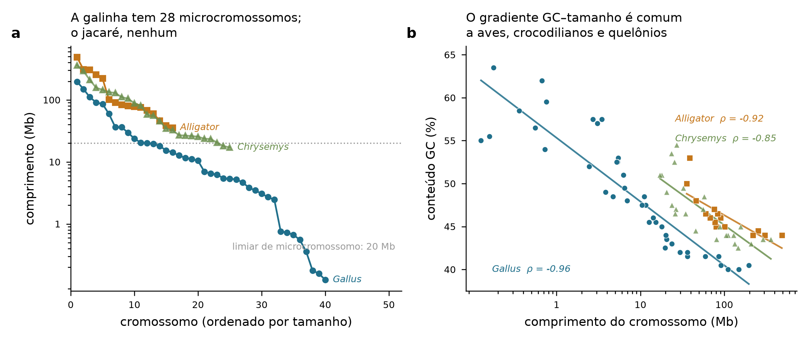
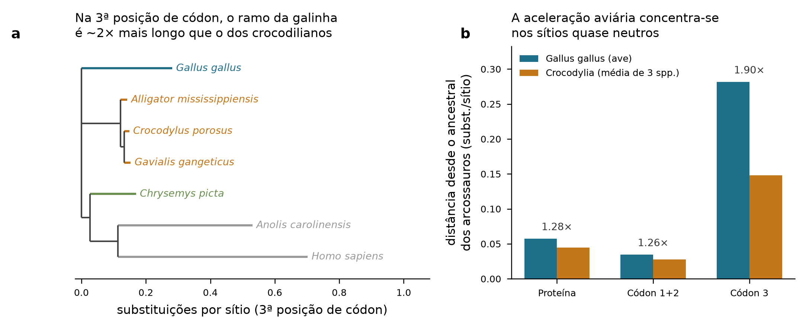
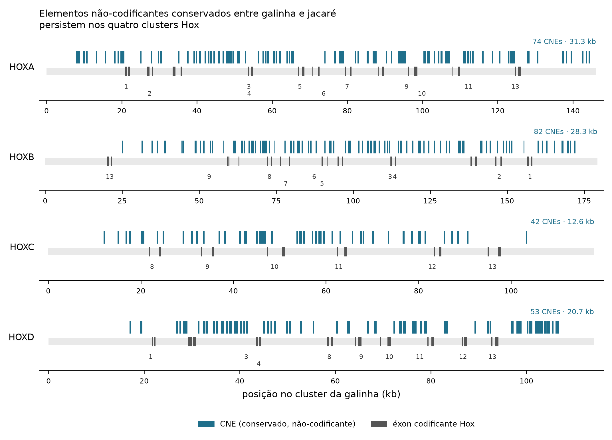

# Genômica comparativa e ontogenia em Archosauria

## *Gallus gallus* frente a *Alligator mississippiensis* e *Crocodylus porosus*

---

## 1. Log de execução

| # | Recurso acionado | Operação | Produto |
|---|---|---|---|
| 1 | **NCBI Datasets v2** (`/genome/taxon/*/dataset_report`) | Relatórios de montagem de referência para 8 táxons | Tabela 1 |
| 2 | **NCBI Datasets v2** (`/genome/accession/*/sequence_reports`) | 686 registros de sequência; comprimento e GC por cromossomo | Tabela 2, Figura 1 |
| 3 | **NCBI Datasets v2** (`/gene/symbol/*/taxon/*`, `/gene/id/*/orthologs`) | Resolução de 50 símbolos gênicos e ortologia 1:1 em 7 táxons | 39 ortólogos |
| 4 | **NCBI Datasets v2** (`/gene/id/*/download`) | 1.634 registros de proteína + CDS; pareamento por tradução exata | `seqs/*.fa` |
| 5 | **MAFFT v7.526** (`--auto`) | 39 alinhamentos proteicos; retrotradução para códons | Supermatriz 24.375 aa / 73.125 nt |
| 6 | **IQ-TREE** (LG+F+G4, GTR+F+G4; UFBoot 1000, SH-aLRT 1000) | Busca ML + comprimentos de ramo em topologia fixa, 3 partições | Tabela 3, Figura 2 |
| 7 | **SciPy** (teste de taxa relativa de Tajima, χ², 1 gl) | Contagem de sítios informativos em 3 enraizamentos | Tabela 4 |
| 8 | **NCBI Gene** + **E-utilities EFetch** | Coordenadas dos 108 genes Hox; 12 regiões genômicas (1,98 Mb) | Tabela 5 |
| 9 | **BLAST+** (`dc-megablast`, `megablast`) | Varredura de elementos conservados galinha × crocodilianos; subtração de éxons | Tabela 6, Figura 3 |
| 10 | **Conector `genomes`** (UCSC) | Inventário de montagens e tracks (`GCF_016699485.2`, `allMis1`, `galGal6`) | Nota metodológica §6 |
| 11 | **Conector `pubmed`** + **CrossRef** | Recuperação e verificação de 57 referências; resolução de DOI | Seção 7 |
| 12 | **PMC** (texto completo, `10.1126/science.1254449`) | Extração de parâmetros publicados de taxa, TE e heterozigosidade | §3.2 |

Ambiente: `archosaur` (Python 3.12, Biopython, MAFFT, IQ-TREE, BLAST+, trimAl). Todos os números das Tabelas 1–6 foram computados nesta sessão a partir de registros públicos; nenhum valor quantitativo foi reproduzido de memória.

---

## 2. Resumo

O contraste genômico entre aves e crocodilianos não é um contraste entre um genoma "avançado" e um "primitivo": é o contraste entre uma linhagem que acelerou e outra que não acelerou, a partir de um ancestral comum já lento. Três resultados independentes obtidos aqui sustentam essa leitura. Primeiro, numa supermatriz de 39 ortólogos 1:1, o ramo de *Gallus* desde o ancestral dos arcossauros é **1,90× mais longo** que o dos crocodilianos nas terceiras posições de códon, mas apenas **1,26–1,28×** nos sítios sob seleção purificadora — a aceleração é predominantemente neutra, não adaptativa. Segundo, o cariótipo: *Gallus* tem 28 microcromossomos que concentram 16,6% do genoma, enquanto *Alligator* não tem nenhum; no entanto, o gradiente que liga tamanho cromossômico a conteúdo GC persiste em ambos (ρ = −0,96 e −0,92), de modo que o compartimento GC-rico e gênico ancestral sobreviveu no jacaré empacotado em cromossomos grandes. Terceiro, 251 elementos não-codificantes conservados, somando 93 kb, permanecem alinháveis entre galinha e jacaré nos quatro clusters Hox, com 79,8% de identidade média após mais de 240 milhões de anos de divergência.

---

## 3. Fase 1 — Genômica comparativa

### 3.1 Estatísticas de montagem e anotação

A montagem de referência do jacaré-americano mudou de patamar: `rAllMis1` (2023) é cromossômica, com N50 de contig de 38,6 Mb — superior ao da galinha. *Crocodylus porosus* e *Gavialis gangeticus* permanecem em montagens de scaffold de 2016, e **as contagens gênicas dessas duas espécies não são comparáveis às demais** (ver §6).

**Tabela 1.** Montagens de referência atuais (NCBI Datasets, consultado nesta sessão).

| Espécie | Acesso | Montagem | Nível | Data | Tamanho (Gb) | GC (%) | N50 contig | N50 scaffold | Scaffolds | Genes | Cod. proteína | Não-cod. | Pseudogenes |
|---|---|---|---|---|---|---|---|---|---|---|---|---|---|
| *Gallus gallus* | GCF_016699485.2 | bGalGal1.mat.broiler.GRCg7b | Cromossomo | 2021-01-19 | 1,053 | 42,0 | 18.834.961 | 90.861.225 | 213 | 25.635 | 18.023 | 7.343 | 198 |
| *Alligator mississippiensis* | GCF_030867095.1 | rAllMis1 | Cromossomo | 2023-08-24 | 2,347 | 45,0 | 38.556.409 | 255.078.640 | 194 | 31.016 | 20.269 | 9.724 | 846 |
| *Crocodylus porosus* | GCF_001723895.1 | CroPor_comp1 | Scaffold | 2016-09-13 | 2,050 | 44,0 | 34.073 | 84.437.661 | 69 | 19.575 | 14.717 | 4.667 | 181 |
| *Gavialis gangeticus* | GCF_001723915.1 | GavGan_comp1 | Scaffold | 2016-09-13 | 2,641 | 44,0 | 14.799 | 96.076.944 | 80 | 18.911 | 14.315 | 4.376 | 197 |
| *Chrysemys picta* | GCF_011386835.1 | ASM1138683v2 | Cromossomo | 2023-09-08 | 2,372 | 45,0 | 13.370.154 | 133.555.881 | 9.850 | 35.699 | 25.216 | 9.241 | 1.155 |
| *Anolis carolinensis* | GCF_035594765.1 | rAnoCar3.1.pri | Cromossomo | 2024-01-12 | 1,851 | 40,5 | 26.091.274 | 288.964.324 | 211 | 27.148 | 20.447 | 6.039 | 628 |

A diferença de tamanho é o dado mais robusto da tabela: o genoma da galinha tem **1,053 Gb contra 2,347 Gb** do jacaré — uma compactação de 55%. Essa redução é anterior às aves modernas; inferências a partir de tamanhos celulares ósseos situam a contração do genoma já em dinossauros saurísquios não-avianos [Organ et al. 2007](https://doi.org/10.1038/nature05621). O genoma crocodiliano, com ~37,5% de conteúdo em elementos transponíveis, ocupa posição intermediária entre mamíferos (40–60%) e aves (12–15%) [Green et al. 2014](https://doi.org/10.1126/science.1254449), e o déficit aviário em TEs explica boa parte do diferencial de 1,3 Gb.

### 3.2 Evolução molecular lenta: quantificação

A alegação de "evolução lenta" foi testada diretamente. Construí uma supermatriz de 39 genes com ortólogos 1:1 em todos os sete táxons (*SHH, BMP4, FGF8, EDA, EDAR, GLI3, PTCH1, SMO, TBX5, TBX20, GATA4, SOX9, PAX6, NOTCH1, JAG1, RAG1, RAG2, FOXP2* e outros), alinhada por MAFFT e retrotraduzida para códons, totalizando 24.375 aminoácidos e 73.125 nucleotídeos. A busca de máxima verossimilhança sem restrição topológica recuperou a árvore aceita: Crocodylia monofilética (UFBoot 100, SH-aLRT 100), Longirostres (*Crocodylus* + *Gavialis*; UFBoot 74, SH-aLRT 88,7) e Archosauria como grupo-irmão de *Chrysemys* (UFBoot 100).

Fixando essa topologia, os comprimentos de ramo medidos **a partir do mesmo nó** — o ancestral comum dos arcossauros, tornam as linhagens diretamente comparáveis, já que o tempo decorrido é idêntico para ambas.

**Tabela 3.** Distância desde o ancestral de Archosauria (substituições por sítio).

| Partição | *Gallus* | *Alligator* | *Crocodylus* | *Gavialis* | Média crocodilianos | Razão ave/croc |
|---|---|---|---|---|---|---|
| Proteína (LG+F+G4) | 0,0576 | 0,0409 | 0,0441 | 0,0498 | 0,0449 | **1,28** |
| Códon pos. 1+2 (GTR+F+G4) | 0,0347 | 0,0245 | 0,0268 | 0,0312 | 0,0275 | **1,26** |
| Códon pos. 3 (GTR+F+G4) | 0,2818 | 0,1426 | 0,1484 | 0,1530 | 0,1480 | **1,90** |

O padrão é informativo. Nas posições 1 e 2 do códon e no nível proteico — sítios majoritariamente sob seleção purificadora, a diferença é de apenas ~26–28%. Nas terceiras posições, majoritariamente sinônimas e portanto próximas da neutralidade, a razão quase dobra. **A aceleração aviária é essencialmente uma aceleração da taxa de mutação-fixação neutra**, não uma assinatura de seleção positiva generalizada. Isso é exatamente o que se espera de uma redução do tempo de geração: [Green et al. 2014](https://doi.org/10.1126/science.1254449) mostram que, assumindo 20 anos de geração para a linhagem crocodiliana, a taxa por geração (7,9 × 10⁻⁹ substituições por sítio) não difere substancialmente da de outras linhagens, o que é baixo é a taxa por ano.

O teste de taxa relativa de Tajima confirma a assimetria com independência de modelo evolutivo.

**Tabela 4.** Teste de taxa relativa de Tajima, *Gallus* × *Alligator* (χ², 1 gl).

| Grupo externo | Sítios | *m₁* (*Gallus*) | *m₂* (*Alligator*) | *m₁*/*m₂* | χ² | *P* |
|---|---|---|---|---|---|---|
| *Chrysemys picta* | todos | 5.030 | 3.095 | 1,63 | 460,8 | 3,2 × 10⁻¹⁰² |
| *Chrysemys picta* | 3ª posição | 3.718 | 2.151 | 1,73 | 418,4 | 5,5 × 10⁻⁹³ |
| *Anolis carolinensis* | todos | 4.075 | 3.428 | 1,19 | 55,8 | 8,1 × 10⁻¹⁴ |
| *Anolis carolinensis* | 3ª posição | 2.923 | 2.500 | 1,17 | 33,0 | 9,2 × 10⁻⁹ |
| *Homo sapiens* | todos | 3.737 | 3.582 | 1,04 | 3,3 | 0,070 |
| *Homo sapiens* | 3ª posição | 2.683 | 2.566 | 1,05 | 2,6 | 0,106 |

A erosão progressiva do sinal com grupos externos mais distantes é o comportamento esperado do teste sob saturação por substituições múltiplas: com *Homo* como referência, sítios que mudaram em ambas as linhagens deixam de ser contabilizados e a assimetria desaparece. O enraizamento com *Chrysemys*, o grupo externo mais próximo, é o estimador adequado, e rejeita a igualdade de taxas de forma inequívoca.

Esses números reproduzem, com dados e métodos independentes, a conclusão de [Green et al. 2014](https://doi.org/10.1126/science.1254449): crocodilianos e quelônios exibem as menores taxas entre tetrápodes, e a evolução rápida dos genomas aviários é uma **autapomorfia** do clado das aves, não a condição ancestral. O corolário é metodologicamente importante: o genoma crocodiliano funciona como aproximação do genoma arcossauriano ancestral, e foi precisamente essa propriedade que permitiu a reconstrução parcial daquele genoma [Green et al. 2014](https://doi.org/10.1126/science.1254449).

### 3.3 Microcromossomos e compartimento GC

**Figura 1.** (a) Cromossomos montados ordenados por tamanho. (b) Conteúdo GC contra comprimento cromossômico, com ajuste linear em escala log. Excluídos cromossomo W e DNA mitocondrial. *n* = 39, 16 e 25 autossomos para *Gallus*, *Alligator* e *Chrysemys*.

**Tabela 2.** Estrutura cariotípica e compartimentalização GC (autossomos montados).

| Espécie | Cromos. montados | Autossomos | Maior (Mb) | Menor autossomo (Mb) | Micro (<20 Mb) | % genoma em micro | GC macro (≥40 Mb) | GC micro | Δ GC |
|---|---|---|---|---|---|---|---|---|---|
| *Gallus gallus* | 41 | 39 | 196,4 | 0,13 | 28 | 16,6 | 40,38 | 47,86 | +7,47 |
| *Taeniopygia guttata* | 41 | 39 | 152,5 | 4,25 | 26 | 20,3 | 39,94 | 49,47 | +9,54 |
| *Chrysemys picta* | 25 | 25 | 360,1 | 17,12 | 2 | 1,6 | 43,88 | 51,00 | +7,12 |
| *Alligator mississippiensis* | 16 | 16 | 486,6 | 35,67 | 0 | 0,0 | 44,67 | — | — |
| *Anolis carolinensis* | 8 | 6 | 368,8 | 120,45 | 0 | 0,0 | 40,46 | — | — |

A correlação de postos entre comprimento cromossômico e GC é forte e negativa em todos os arcossauros e no quelônio: *Gallus* ρ = −0,955 (*n* = 39; *P* = 4,4 × 10⁻²¹), *Taeniopygia* ρ = −0,901 (*P* = 5,2 × 10⁻¹⁵), *Alligator* ρ = −0,921 (*n* = 16; *P* = 4,3 × 10⁻⁷), *Chrysemys* ρ = −0,849 (*P* = 7,9 × 10⁻⁸). Em *Anolis*, com apenas 6 autossomos montados e todos macrocromossômicos, não há relação detectável (ρ = +0,494; *P* = 0,32).

Esse é o achado mais interessante da Fase 1, e ele qualifica a narrativa usual. Microcromossomos são descritos como elementos gênicos, GC-ricos e pobres em TEs, e a comparação cariotípica ampla mostra que eles são **ancestrais** em amniotas, tendo sido perdidos por fusão de modo independente em quelônios e escamados [Waters et al. 2021](https://doi.org/10.1073/pnas.2112494118). Os dados aqui dizem que, no jacaré, a fusão apagou os microcromossomos como entidades citogenéticas **sem apagar o compartimento genômico que eles carregavam**: o gradiente GC–tamanho sobrevive intacto em um cariótipo de 2n = 32 composto só de macrocromossomos. A arquitetura isocórica, portanto, não depende da existência de cromossomos pequenos — ela é uma propriedade conservada do genoma arcossauriano, apenas reembalada.

A conservação de sintenia aparece com nitidez nos clusters Hox. Em *Gallus*, os quatro clusters ocupam quatro cromossomos distintos — HOXA no cromossomo 2, HOXB no 27, HOXC no 34, HOXD no 7, sendo dois deles microcromossomos. Em *Alligator*, **HOXB e HOXD estão ambos no cromossomo 4**, separados por cerca de 41 Mb. Lida à luz de [Waters et al. 2021](https://doi.org/10.1073/pnas.2112494118), a interpretação parcimoniosa é que o cromossomo 4 do jacaré resulta da fusão de elementos ancestrais que as aves retiveram separados, e não de fissão na linhagem aviária.

**Tabela 5.** Localização e extensão dos clusters Hox (coordenadas das montagens de referência).

| Cluster | *Gallus* — cromossomo | Extensão (kb) | *Alligator* — cromossomo | Extensão (kb) | *Crocodylus* — extensão (kb) |
|---|---|---|---|---|---|
| HOXA | 2 | 106,2 | 5 | 110,9 | 115,4 |
| HOXB | 27 (micro) | 139,3 | 4 | 181,5 | 182,7 |
| HOXC | 34 (micro) | 78,0 | 15 | 168,1 | 76,7 |
| HOXD | 7 | 74,2 | 4 | 88,2 | 74,4 |

A ordem gênica colinear está preservada nos três genomas. As extensões crocodilianas são iguais ou maiores que as aviárias, coerente com a compactação do genoma das aves; o valor discrepante de HOXC em *Alligator* (168,1 kb contra 76,7 kb em *Crocodylus*) deve ser tratado com cautela, por envolver nove genes anotados em uma montagem e seis na outra.

---

## 4. Fase 2 — Filogenia e tempo profundo

**Figura 2.** (a) Filograma de máxima verossimilhança nas terceiras posições de códon (GTR+F+G4, topologia fixa). (b) Distância desde o ancestral dos arcossauros por partição; rótulos indicam a razão ave/crocodiliano. Supermatriz de 39 ortólogos 1:1, 73.125 nt, 7 táxons.

### 4.1 A bifurcação basal de Archosauria

Archosauria divide-se em dois ramos no Triássico Inferior: **Avemetatarsalia** (= Ornithodira), que conduz a pterossauros, dinossauros e aves, e **Pseudosuchia** (= Crurotarsi *sensu lato*), que conduz a aetossauros, rauissúquios, fitossauros e crocodilomorfos. A delimitação dessas linhagens e a distribuição de suas sinapomorfias foram estabelecidas pelas revisões filogenéticas amplas de [Brusatte et al. 2010](https://doi.org/10.1080/14772010903537732) e [Nesbitt 2011](https://doi.org/10.1206/352.1), e o contexto archosauromorfo mais basal por [Ezcurra 2016](https://doi.org/10.7717/peerj.1778).

O caráter diagnóstico clássico é a articulação do tornozelo. Pseudosuquios conservam a articulação **crurotarsal**, em que o plano de rotação passa entre astrágalo e calcâneo, com o calcâneo portando um tubérculo que atua como braço de alavanca para a musculatura — a base mecânica da postura semi-ereta e da marcha "high walk" dos crocodilianos atuais. Avemetatarsálios desenvolvem a articulação **mesotarsal**, uma dobradiça simples entre a fileira proximal do tarso e o metatarso, pré-requisito da postura digitígrada e parassagital. Ambos os estados derivam de um ancestral arcossauriforme, e a assimetria de sobrevivência, a extinção do final do Triássico eliminou quase toda a diversidade pseudosúquia, explica por que os dois ramos chegam ao presente com disparidades de riqueza tão diferentes.

Neste trabalho não foi feita datação molecular; as estimativas temporais abaixo são da literatura. A divergência ave–crocodiliano é calibrada por fósseis no limite Permiano–Triássico a Triássico Inferior, com limite mínimo em torno de 247 Ma [Benton & Donoghue 2006](https://doi.org/10.1093/molbev/msl150), e análises filogenômicas de vertebrados com calibração fóssil situam a separação na mesma janela [Irisarri et al. 2017](https://doi.org/10.1038/s41559-017-0240-5). A escala temporal de [Hedges et al. 2015](https://doi.org/10.1093/molbev/msv037) é a referência consolidada para datas secundárias. O valor de ~240–250 Ma é o que se deve usar ao converter as distâncias da Tabela 3 em taxas absolutas.

### 4.2 Interface com o registro fóssil

A convergência entre genômica e paleontologia é mais produtiva em dois pontos.

O primeiro é a **fisiologia do ancestral**. A morfologia cardiovascular dos crocodilianos atuais — coração completamente septado, com musculatura ventricular esquerda espessa, é difícil de conciliar com um ancestral ectotérmico, e [Seymour et al. 2004](https://doi.org/10.1086/422766) argumentam que o padrão é mais bem explicado como herança de um estoque arcossauriano de metabolismo elevado, com o ectotermismo crocodiliano sendo secundariamente derivado em associação ao modo de vida de emboscada aquática. A análise paleo-histológica de [Legendre et al. 2016](https://doi.org/10.1093/sysbio/syw033), baseada em taxas de crescimento ósseo inferidas, chega a conclusão convergente: a taxa metabólica basal elevada mapeia na base de Archosauria, não apenas em Avemetatarsalia. O genoma concorda de forma indireta: a redução do tamanho do genoma, correlacionada a tamanho celular e a demanda metabólica, já está presente em dinossauros não-avianos [Organ et al. 2007](https://doi.org/10.1038/nature05621).

O segundo é a **origem das penas**. Os elementos regulatórios associados a genes de desenvolvimento de pena não são inovações de Dinosauria: [Lowe et al. 2014](https://doi.org/10.1093/molbev/msu309) estimam que 86% desses elementos e 100% do conjunto não-queratínico de genes de pena já existiam antes da origem de Dinosauria, com picos de inovação regulatória nos ancestrais de amniotas e de arcossauros. A inovação morfológica da pena, portanto, recrutou um aparato genético preexistente — e fósseis cretácicos com preservação molecular de queratina e melanossomos [Pan et al. 2016](https://doi.org/10.1073/pnas.1617168113) documentam a estrutura resultante.

---

## 5. Fase 3 — Ontogenia e homologia profunda

### 5.1 Sistemas de estadiamento

Os dois sistemas de referência são morfológicos, não cronológicos, o que é essencial porque o desenvolvimento crocodiliano é termicamente dependente. A série de Hamburger e Hamilton define 46 estágios para *Gallus* com base em somitos, brotos de membro e caracteres de plumagem e bico [Hamburger & Hamilton 1951](https://doi.org/10.1002/jmor.1050880104), reeditada em [Hamburger & Hamilton 1992](https://doi.org/10.1002/aja.1001950404). Para crocodilianos, a série de referência para *Alligator mississippiensis* é a de Ferguson (1985), publicada como capítulo em *Biology of the Reptilia* e, por ser um capítulo de livro, não recuperável pelos conectores desta sessão — por isso a tabela abaixo descreve marcos morfológicos em vez de atribuir números de estágio de Ferguson. A série equivalente para *Caiman latirostris*, acessível e com DOI, é a de [Iungman et al. 2008](https://doi.org/10.1002/dvg.20494).

**Tabela 7.** Marcos ontogenéticos comparados. Estágios HH e tempos para *Gallus* a ~37,5 °C conforme [Hamburger & Hamilton 1951](https://doi.org/10.1002/jmor.1050880104); tempos crocodilianos referem-se a incubação a ~30–32 °C. Valores aproximados.

| Marco morfológico | *Gallus* (HH) | Crocodylia | Relevância comparativa |
|---|---|---|---|
| Linha primitiva definitiva | HH 4 (~18–19 h) | pré-oviposição | Ovos de crocodiliano são postos em estágio mais avançado |
| Neurulação, 1–10 somitos | HH 7–10 (~24–33 h) | primeiros dias | Conservado |
| Arcos faríngeos, rotação | HH 14–17 (~2–2,5 d) | ~10% da incubação | Base do esqueleto craniofacial |
| Broto de membro visível | HH 18–20 (~3 d) | ~15% da incubação | ZPA/AER homólogas |
| Placa da mão, raios digitais | HH 24–26 (~4,5–5 d) | ~25–30% | Identidade digital divergente |
| Período termossensível (determinação sexual) | ausente (ZW genético) | terço médio da incubação | Ver §5.4 |
| Primeiras gemas de apêndice epidérmico | HH 29–32 (~6–7,5 d) | ~35–45% | Placódio anatômico compartilhado |
| Septação ventricular completa | ~HH 34–36 | meio da incubação | Ver §5.3 |
| Queratinização de bico/escamas | HH 36–38 (~10–12 d) | segunda metade | β-queratinas arcossaurianas |
| Eclosão | HH 46 (~21 d) | ~65–75 d | Ambos precociais |

### 5.2 Placódios epidérmicos e apêndices cutâneos

Esta é a questão evo-devo em que a resposta mudou na última década. O argumento histórico contra a homologia entre pena e escama era a ausência aparente, em répteis, do **placódio anatômico** — o espessamento epidérmico local que caracteriza a morfogênese inicial de penas e pelos. [Di-Poï & Milinkovitch 2016](https://doi.org/10.1126/sciadv.1600708) demonstraram, com séries de desenvolvimento de crocodilianos e serpentes e com lagartos mutantes deficientes em **EDA**, que o placódio anatômico existe no desenvolvimento da escama reptiliana; a conclusão é que os apêndices cutâneos de amniotas descendem de um placódio ancestral único, e não de co-opções paralelas de vias semelhantes.

Os dados desta sessão são coerentes com esse quadro no nível mais básico: **EDA e EDAR estão entre os 39 genes com ortologia 1:1 inequívoca** nos sete táxons analisados, incluindo os três crocodilianos — o eixo de sinalização que define o placódio está integralmente presente e em cópia única em toda a Archosauria. A evidência molecular complementar vem da localização nuclear de β-catenina, compartilhada entre primórdios de pena, escamas escutadas de ave e escamas de jacaré nos estágios iniciais [Musser et al. 2015](https://doi.org/10.1111/ede.12123), e da arquitetura de ondas acopladas de sinalização e densidade celular que organiza as fileiras de penas [Ho et al. 2019](https://doi.org/10.1371/journal.pbio.3000132).

A divergência, portanto, não está na origem do placódio, mas no que acontece depois dele: na elaboração morfogenética subsequente e no repertório de **β-queratinas**, a família multigênica específica de sauropsídeos cuja expansão e subfuncionalização acompanham a diversificação dos apêndices [Greenwold & Sawyer 2010](https://doi.org/10.1186/1471-2148-10-148); as β-queratinas da epiderme crocodiliana formam um conjunto distinto, com relações filogenéticas próprias dentro dessa radiação [Valle et al. 2008](https://doi.org/10.1002/jez.b.21241), e o mapeamento topográfico de α- e β-queratinas na pele embrionária de galinha mostra como os dois sistemas se repartem espacialmente durante a construção do apêndice [Wu et al. 2015](https://doi.org/10.1073/pnas.1520566112). O enquadramento conceitual mais amplo de evo-devo dos tegumentos amniotas é o de [Wu et al. 2004](https://doi.org/10.1387/ijdb.15272390), e os modelos clássicos de origem da pena por novidade morfogenética são os de [Prum 1999](https://doi.org/10.1002/%28sici%291097-010x%2819991215%29285:4<291::aid-jez1>3.0.co;2-9) e [Sawyer & Knapp 2003](https://doi.org/10.1002/jez.b.26).

### 5.3 O coração de quatro câmaras

Aves e crocodilianos compartilham septação ventricular completa; mamíferos também a possuem, mas por via independente. [Koshiba-Takeuchi et al. 2009](https://doi.org/10.1038/nature08324) examinaram o desenvolvimento ventricular em tartaruga e em *Anolis* e mostraram que a septação completa emerge de um gradiente de expressão de **Tbx5**: répteis não-arcossaurianos formam inicialmente uma câmara ventricular com expressão homogênea, e a transição para um gradiente ântero-posterior nítido acompanha a aquisição da parede divisória. O quadro geral do plano de construção cardíaco dos vertebrados é revisto por [Jensen et al. 2013](https://doi.org/10.1016/j.bbamcr.2012.10.004), e o papel do epicárdio na septação ao longo da evolução amniota por [Poelmann et al. 2014](https://doi.org/10.1371/journal.pone.0106569).

A leitura mais parcimoniosa é que a septação ventricular completa é **homóloga dentro de Archosauria** — presente no ancestral comum de aves e crocodilianos, e **convergente** em relação à condição mamífera. O que é derivado nos crocodilianos é a sobreposição de um sistema de desvio: o arco aórtico esquerdo persiste emergindo do ventrículo direito e comunica-se com o direito pelo **forame de Panizza**, permitindo shunt direita-esquerda durante o mergulho. Essa arquitetura é uma especialização para vida aquática construída sobre um coração já completamente septado, o que é consistente com a hipótese de ancestralidade endotérmica discutida em §4.2 [Seymour et al. 2004](https://doi.org/10.1086/422766).

### 5.4 Desenvolvimento craniofacial e determinação sexual

O crânio aviário é derivado de forma que o crocodiliano não é. [Bhullar et al. 2012](https://doi.org/10.1038/nature11146) mostram, por análise morfométrica ao longo da linhagem dinossauro–ave, que o crânio das aves modernas é **pedomórfico**: retém proporções juvenis de ancestrais não-avianos, com expansão do neurocrânio e encurtamento facial. [Bhullar et al. 2015](https://doi.org/10.1111/evo.12684) identificam o mecanismo de desenvolvimento correspondente — uma alteração na zona mediana de sinalização facial que funde os primórdios pré-maxilares e origina o bico. A base experimental dessa zona de sinalização é o trabalho sobre o ectoderma frontonasal e o eixo Shh/Fgf8 [Hu et al. 2003](https://doi.org/10.1242/dev.00397), e a demonstração de que variação quantitativa em **BMP4** produz variação de forma de bico vem dos tentilhões de Darwin [Abzhanov et al. 2004](https://doi.org/10.1126/science.1098095). O focinho longo e tubular do crocodiliano, por contraste, é a condição mais próxima do estado arcossauriano ancestral; a morfogênese do palato em *Alligator* foi descrita em detalhe por [Ferguson 1981](https://doi.org/10.1016/0003-9969%2881%2990041-8). A questão clássica correlata, a identidade dos dígitos da asa, permanece em debate, com os argumentos revisados por [Young et al. 2011](https://doi.org/10.1002/dvdy.22595).

A determinação sexual separa as duas linhagens de modo absoluto, e isso é visível no cariótipo montado. A galinha tem sistema ZW genético; na Tabela 2, *Alligator* apresenta **16 autossomos e nenhum par sexual**, coerente com determinação sexual dependente da temperatura. A dinâmica transcricional gonadal correspondente em *A. mississippiensis* foi caracterizada por [Yatsu et al. 2016](https://doi.org/10.1186/s12864-016-2396-9), e o mecanismo epigenético subjacente — regulação por desmetilase de histona sensível à temperatura, foi estabelecido em quelônio por [Ge et al. 2018](https://doi.org/10.1126/science.aap8328).

### 5.5 Conservação regulatória nos clusters Hox

**Figura 3.** Blocos conservados ao longo dos quatro clusters Hox da galinha, detectados por `dc-megablast` contra as regiões ortólogas de *Alligator*. Éxons codificantes identificados por alinhamento dos CDS Hox contra a própria região; blocos com menos de 20% de sobreposição com éxon são classificados como CNE. Regiões com flancos de 20 kb.

Os quatro clusters Hox são o teste mais direto de conservação regulatória profunda, porque sua arquitetura cis-regulatória é funcionalmente indissociável da ordem gênica [Tschopp & Duboule 2011](https://doi.org/10.1146/annurev-genet-102209-163429) e organiza-se em domínios topológicos estáveis [Lonfat & Duboule 2015](https://doi.org/10.1016/j.febslet.2015.04.024).

**Tabela 6.** Elementos conservados galinha × crocodilianos nas regiões Hox.

| Cluster | Região (kb) | Alvo | Blocos conservados | % região conservada | CNEs | CNE (bp) | % região em CNE | Mediana (bp) | Máximo (bp) | Identidade não-cod. (%) |
|---|---|---|---|---|---|---|---|---|---|---|
| HOXA | 146,2 | *Alligator* | 110 | 34,56 | 74 | 31.324 | 21,43 | 329 | 2.109 | 78,6 |
| HOXB | 179,3 | *Alligator* | 125 | 23,94 | 82 | 28.347 | 15,81 | 230 | 1.556 | 80,3 |
| HOXC | 118,0 | *Alligator* | 65 | 17,05 | 42 | 12.643 | 10,71 | 234 | 1.530 | 78,9 |
| HOXD | 114,2 | *Alligator* | 83 | 28,74 | 53 | 20.717 | 18,15 | 325 | 1.079 | 81,5 |
| **Total** | **557,7** | *Alligator* | — | — | **251** | **93.031** | **16,7** | — | **2.109** | **79,8** |
| **Total** | **557,7** | *Crocodylus* | — | — | **245** | **91.364** | **16,4** | — | **2.030** | **79,7** |

A concordância entre os dois crocodilianos — 251 contra 245 CNEs, 93,0 contra 91,4 kb, é esperada, dado que ambos compartilham a mesma distância filogenética até a galinha, e funciona como controle interno do procedimento.

Três leituras importam. Primeira, **16,7% de regiões de ~140 kb permanecem alinháveis em sequência não-codificante** após mais de 240 Ma, com identidade média de 79,8%; isso é conservação muito acima do neutro e identifica elementos sob restrição funcional. Segunda, o maior CNE detectado tem **2.109 bp** em HOXA — um bloco regulatório contíguo de escala comparável aos elementos ultraconservados definidos em vertebrados [Bejerano et al. 2004](https://doi.org/10.1126/science.1098119) e usados como marcadores filogenômicos em arcossauros e quelônios [Crawford et al. 2012](https://doi.org/10.1098/rsbl.2012.0331). Terceira, a densidade de CNE varia entre clusters de forma consistente nos dois alvos, HOXA e HOXD retêm proporcionalmente mais sequência regulatória que HOXC, padrão coerente com o papel dominante de HOXA/HOXD na padronização dos membros, precisamente o sistema em que aves e crocodilianos divergem morfologicamente mais.

O número de 251 CNEs é um **limite inferior**. A detecção por BLAST entre pares recupera apenas blocos com similaridade contígua suficiente; abordagens com alinhamento de múltiplas espécies e modelos de taxa (phastCons/phyloP) recuperam conjuntos substancialmente maiores, da ordem de centenas de milhares de elementos em escala genômica [Lowe et al. 2014](https://doi.org/10.1093/molbev/msu309).

---

## 6. Limitações

**Comparabilidade das anotações.** As contagens gênicas de *Crocodylus porosus* (14.717 codificantes de proteína) e *Gavialis gangeticus* (14.315) provêm de montagens de scaffold de 2016, com N50 de contig de 34 kb e 15 kb. Esses valores refletem fragmentação de montagem e versão de anotação, **não** conteúdo gênico real, e não devem ser contrastados com os 20.269 de *Alligator* ou os 18.023 de *Gallus*. A montagem de referência de alta qualidade de *C. porosus* é descrita por [Ghosh et al. 2019](https://doi.org/10.1093/gbe/evz269); o conjunto original dos três genomas crocodilianos é de [Green et al. 2014](https://doi.org/10.1126/science.1254449) e [John et al. 2012](https://doi.org/10.1186/gb-2012-13-1-415).

**Amostragem gênica.** As taxas da Tabela 3 derivam de 39 genes escolhidos por serem conservados e por terem ortologia 1:1 inequívoca, com forte representação de reguladores do desenvolvimento. Esse conjunto é conservador: genes sob restrição intensa subestimam a razão de taxas em sítios neutros. A razão de 1,90 nas terceiras posições deve ser lida como estimativa mínima da aceleração aviária, não como média genômica.

**Sem datação molecular.** Não foi realizada inferência de tempos de divergência. Todas as datas citadas são da literatura, e as distâncias da Tabela 3 são substituições por sítio, não taxas por ano.

**Fontes de conservação não utilizadas.** O conector UCSC foi consultado e serve a montagem GRCg7b (`GCF_016699485.2`) com os mesmos acessos NC_ do NCBI, mas esse hub não expõe tracks phastCons/phyloP; as tracks `phastCons77way` e `phastConsElements77way` existem apenas para `galGal6`, cujas coordenadas não correspondem às usadas aqui. Por isso a detecção de CNE foi feita por alinhamento direto, sem recorrer a elementos conservados pré-computados.

**Estadiamento crocodiliano.** A série de Ferguson (1985) não foi recuperada; a Tabela 7 apresenta marcos morfológicos e frações de incubação, não números de estágio dessa série.

**Dados genômicos adicionais.** Contexto comparativo mais amplo de genômica de sauropsídeos está em [Janes et al. 2010](https://doi.org/10.1146/annurev-genom-082509-141646), [Shedlock et al. 2007](https://doi.org/10.1073/pnas.0606204104), [Alföldi et al. 2011](https://doi.org/10.1038/nature10390), [Eckalbar et al. 2013](https://doi.org/10.1186/1471-2164-14-49) e [Tzika et al. 2011](https://doi.org/10.1186/2041-9139-2-19); para genômica aviária em escala de clado, [Zhang et al. 2014](https://doi.org/10.1126/science.1251385) e [Jarvis et al. 2014](https://doi.org/10.1126/science.1253451); para montagens da galinha, [Consortium 2004](https://doi.org/10.1038/nature03154), [Warren et al. 2017](https://doi.org/10.1534/g3.116.035923) e [Huang et al. 2023](https://doi.org/10.1073/pnas.2216641120); para o quelônio, [Shaffer et al. 2013](https://doi.org/10.1186/gb-2013-14-3-r28); para evolução cromossômica aviária e arcossauriana, [Burt 2002](https://doi.org/10.1159/000063018), [Romanov et al. 2014](https://doi.org/10.1186/1471-2164-15-1060), [Farré et al. 2016](https://doi.org/10.1093/gbe/evw166) e [O’Connor et al. 2018](https://doi.org/10.1038/s41467-018-04267-9).

---

## 7. Referências

1. Abzhanov, Protas, Grant et al. (2004). Bmp4 and Morphological Variation of Beaks in Darwin's Finches. *Science*. [10.1126/science.1098095](https://doi.org/10.1126/science.1098095)
2. Alföldi, Di Palma, Grabherr et al. (2011). The genome of the green anole lizard and a comparative analysis with birds and mammals. *Nature*. [10.1038/nature10390](https://doi.org/10.1038/nature10390)
3. Bejerano, Pheasant, Makunin et al. (2004). Ultraconserved Elements in the Human Genome. *Science*. [10.1126/science.1098119](https://doi.org/10.1126/science.1098119)
4. Benton, Donoghue (2006). Paleontological Evidence to Date the Tree of Life. *Molecular Biology and Evolution*. [10.1093/molbev/msl150](https://doi.org/10.1093/molbev/msl150)
5. Bhullar, Marugán-Lobón, Racimo et al. (2012). Birds have paedomorphic dinosaur skulls. *Nature*. [10.1038/nature11146](https://doi.org/10.1038/nature11146)
6. Bhullar, Morris, Sefton et al. (2015). A molecular mechanism for the origin of a key evolutionary innovation, the bird beak and palate, revealed by an integrative approach to major transitions in vertebrate history. *Evolution*. [10.1111/evo.12684](https://doi.org/10.1111/evo.12684)
7. Brusatte, Benton, Desojo et al. (2010). The higher-level phylogeny of Archosauria (Tetrapoda: Diapsida). *Journal of Systematic Palaeontology*. [10.1080/14772010903537732](https://doi.org/10.1080/14772010903537732)
8. Burt (2002). Origin and evolution of avian microchromosomes. *Cytogenetic and Genome Research*. [10.1159/000063018](https://doi.org/10.1159/000063018)
9. International Chicken Genome Sequencing Consortium (2004). Sequence and comparative analysis of the chicken genome provide unique perspectives on vertebrate evolution. *Nature*. [10.1038/nature03154](https://doi.org/10.1038/nature03154)
10. Crawford, Faircloth, McCormack et al. (2012). More than 1000 ultraconserved elements provide evidence that turtles are the sister group of archosaurs. *Biology Letters*. [10.1098/rsbl.2012.0331](https://doi.org/10.1098/rsbl.2012.0331)
11. Di-Poï, Milinkovitch (2016). The anatomical placode in reptile scale morphogenesis indicates shared ancestry among skin appendages in amniotes. *Science Advances*. [10.1126/sciadv.1600708](https://doi.org/10.1126/sciadv.1600708)
12. Eckalbar, Hutchins, Markov et al. (2013). Genome reannotation of the lizard Anolis carolinensis based on 14 adult and embryonic deep transcriptomes. *BMC Genomics*. [10.1186/1471-2164-14-49](https://doi.org/10.1186/1471-2164-14-49)
13. Ezcurra (2016). The phylogenetic relationships of basal archosauromorphs, with an emphasis on the systematics of proterosuchian archosauriforms. *PeerJ*. [10.7717/peerj.1778](https://doi.org/10.7717/peerj.1778)
14. Farré, Narayan, Slavov et al. (2016). Novel Insights into Chromosome Evolution in Birds, Archosaurs, and Reptiles. *Genome Biology and Evolution*. [10.1093/gbe/evw166](https://doi.org/10.1093/gbe/evw166)
15. Ferguson (1981). The structure and development of the palate in Alligator mississippiensis. *Archives of Oral Biology*. [10.1016/0003-9969(81)90041-8](https://doi.org/10.1016/0003-9969%2881%2990041-8)
16. Ge, Ye, Weber et al. (2018). The histone demethylase KDM6B regulates temperature-dependent sex determination in a turtle species. *Science*. [10.1126/science.aap8328](https://doi.org/10.1126/science.aap8328)
17. Ghosh, Johnson, Osmanski et al. (2019). A High-Quality Reference Genome Assembly of the Saltwater Crocodile, Crocodylus porosus, Reveals Patterns of Selection in Crocodylidae. *Genome Biology and Evolution*. [10.1093/gbe/evz269](https://doi.org/10.1093/gbe/evz269)
18. Green, Braun, Armstrong et al. (2014). Three crocodilian genomes reveal ancestral patterns of evolution among archosaurs. *Science*. [10.1126/science.1254449](https://doi.org/10.1126/science.1254449)
19. Greenwold, Sawyer (2010). Genomic organization and molecular phylogenies of the beta (β) keratin multigene family in the chicken (Gallus gallus) and zebra finch (Taeniopygia guttata): implications for feather evolution. *BMC Evolutionary Biology*. [10.1186/1471-2148-10-148](https://doi.org/10.1186/1471-2148-10-148)
20. Hamburger, Hamilton (1951). A series of normal stages in the development of the chick embryo. *Journal of Morphology*. [10.1002/jmor.1050880104](https://doi.org/10.1002/jmor.1050880104)
21. Hamburger, Hamilton (1992). A series of normal stages in the development of the chick embryo. *Developmental Dynamics*. [10.1002/aja.1001950404](https://doi.org/10.1002/aja.1001950404)
22. Hedges, Marin, Suleski et al. (2015). Tree of Life Reveals Clock-Like Speciation and Diversification. *Molecular Biology and Evolution*. [10.1093/molbev/msv037](https://doi.org/10.1093/molbev/msv037)
23. Ho, Freem, Zhao et al. (2019). Feather arrays are patterned by interacting signalling and cell density waves. *PLOS Biology*. [10.1371/journal.pbio.3000132](https://doi.org/10.1371/journal.pbio.3000132)
24. Hu, Marcucio, Helms (2003). A zone of frontonasal ectoderm regulates patterning and growth in the face. *Development*. [10.1242/dev.00397](https://doi.org/10.1242/dev.00397)
25. Huang, Xu, Bai et al. (2023). Evolutionary analysis of a complete chicken genome. *Proceedings of the National Academy of Sciences*. [10.1073/pnas.2216641120](https://doi.org/10.1073/pnas.2216641120)
26. Irisarri, Baurain, Brinkmann et al. (2017). Phylotranscriptomic consolidation of the jawed vertebrate timetree. *Nature Ecology & Evolution*. [10.1038/s41559-017-0240-5](https://doi.org/10.1038/s41559-017-0240-5)
27. Iungman, Piña, Siroski (2008). Embryological development of Caiman latirostris (Crocodylia: Alligatoridae). *genesis*. [10.1002/dvg.20494](https://doi.org/10.1002/dvg.20494)
28. Janes, Organ, Fujita et al. (2010). Genome Evolution in Reptilia, the Sister Group of Mammals. *Annual Review of Genomics and Human Genetics*. [10.1146/annurev-genom-082509-141646](https://doi.org/10.1146/annurev-genom-082509-141646)
29. Jarvis, Mirarab, Aberer et al. (2014). Whole-genome analyses resolve early branches in the tree of life of modern birds. *Science*. [10.1126/science.1253451](https://doi.org/10.1126/science.1253451)
30. Jensen, Wang, Christoffels et al. (2013). Evolution and development of the building plan of the vertebrate heart. *Biochimica et Biophysica Acta (BBA) - Molecular Cell Research*. [10.1016/j.bbamcr.2012.10.004](https://doi.org/10.1016/j.bbamcr.2012.10.004)
31. St John, Braun, Isberg et al. (2012). Sequencing three crocodilian genomes to illuminate the evolution of archosaurs and amniotes. *Genome Biology*. [10.1186/gb-2012-13-1-415](https://doi.org/10.1186/gb-2012-13-1-415)
32. Koshiba-Takeuchi, Mori, Kaynak et al. (2009). Reptilian heart development and the molecular basis of cardiac chamber evolution. *Nature*. [10.1038/nature08324](https://doi.org/10.1038/nature08324)
33. Legendre, Guénard, Botha-Brink et al. (2016). Palaeohistological Evidence for Ancestral High Metabolic Rate in Archosaurs. *Systematic Biology*. [10.1093/sysbio/syw033](https://doi.org/10.1093/sysbio/syw033)
34. Lonfat, Duboule (2015). Structure, function and evolution of topologically associating domains (TADs) atHOX loci. *FEBS Letters*. [10.1016/j.febslet.2015.04.024](https://doi.org/10.1016/j.febslet.2015.04.024)
35. Lowe, Clarke, Baker et al. (2014). Feather Development Genes and Associated Regulatory Innovation Predate the Origin of Dinosauria. *Molecular Biology and Evolution*. [10.1093/molbev/msu309](https://doi.org/10.1093/molbev/msu309)
36. Musser, Wagner, Prum (2015). Nuclear β‐catenin localization supports homology of feathers, avian scutate scales, and alligator scales in early development. *Evolution & Development*. [10.1111/ede.12123](https://doi.org/10.1111/ede.12123)
37. Nesbitt (2011). The Early Evolution of Archosaurs: Relationships and the Origin of Major Clades. *Bulletin of the American Museum of Natural History*. [10.1206/352.1](https://doi.org/10.1206/352.1)
38. Organ, Shedlock, Meade et al. (2007). Origin of avian genome size and structure in non-avian dinosaurs. *Nature*. [10.1038/nature05621](https://doi.org/10.1038/nature05621)
39. O’Connor, Romanov, Kiazim et al. (2018). Reconstruction of the diapsid ancestral genome permits chromosome evolution tracing in avian and non-avian dinosaurs. *Nature Communications*. [10.1038/s41467-018-04267-9](https://doi.org/10.1038/s41467-018-04267-9)
40. Pan, Zheng, Moyer et al. (2016). Molecular evidence of keratin and melanosomes in feathers of the Early Cretaceous bird Eoconfuciusornis. *Proceedings of the National Academy of Sciences*. [10.1073/pnas.1617168113](https://doi.org/10.1073/pnas.1617168113)
41. Poelmann, Groot, Vicente-Steijn et al. (2014). Evolution and Development of Ventricular Septation in the Amniote Heart. *PLoS ONE*. [10.1371/journal.pone.0106569](https://doi.org/10.1371/journal.pone.0106569)
42. Prum (1999). Development and evolutionary origin of feathers. *The Journal of Experimental Zoology*. [10.1002/(sici)1097-010x(19991215)285:4<291::aid-jez1>3.0.co;2-9](https://doi.org/10.1002/%28sici%291097-010x%2819991215%29285:4<291::aid-jez1>3.0.co;2-9)
43. Romanov, Farré, Lithgow et al. (2014). Reconstruction of gross avian genome structure, organization and evolution suggests that the chicken lineage most closely resembles the dinosaur avian ancestor. *BMC Genomics*. [10.1186/1471-2164-15-1060](https://doi.org/10.1186/1471-2164-15-1060)
44. Sawyer, Knapp (2003). Avian skin development and the evolutionary origin of feathers. *Journal of Experimental Zoology Part B: Molecular and Developmental Evolution*. [10.1002/jez.b.26](https://doi.org/10.1002/jez.b.26)
45. Seymour, Bennett‐Stamper, Johnston et al. (2004). Evidence for Endothermic Ancestors of Crocodiles at the Stem of Archosaur Evolution. *Physiological and Biochemical Zoology*. [10.1086/422766](https://doi.org/10.1086/422766)
46. Bradley Shaffer, Minx, Warren et al. (2013). The western painted turtle genome, a model for the evolution of extreme physiological adaptations in a slowly evolving lineage. *Genome Biology*. [10.1186/gb-2013-14-3-r28](https://doi.org/10.1186/gb-2013-14-3-r28)
47. Shedlock, Botka, Zhao et al. (2007). Phylogenomics of nonavian reptiles and the structure of the ancestral amniote genome. *Proceedings of the National Academy of Sciences*. [10.1073/pnas.0606204104](https://doi.org/10.1073/pnas.0606204104)
48. Tschopp, Duboule (2011). A Genetic Approach to the Transcriptional Regulation ofHoxGene Clusters. *Annual Review of Genetics*. [10.1146/annurev-genet-102209-163429](https://doi.org/10.1146/annurev-genet-102209-163429)
49. Tzika, Helaers, Schramm et al. (2011). Reptilian-transcriptome v1.0, a glimpse in the brain transcriptome of five divergent Sauropsida lineages and the phylogenetic position of turtles. *EvoDevo*. [10.1186/2041-9139-2-19](https://doi.org/10.1186/2041-9139-2-19)
50. Dalla Valle, Nardi, Gelmi et al. (2008). β‐keratins of the crocodilian epidermis: composition, structure, and phylogenetic relationships. *Journal of Experimental Zoology Part B: Molecular and Developmental Evolution*. [10.1002/jez.b.21241](https://doi.org/10.1002/jez.b.21241)
51. Warren, Hillier, Tomlinson et al. (2017). A New Chicken Genome Assembly Provides Insight into Avian Genome Structure. *G3 Genes|Genomes|Genetics*. [10.1534/g3.116.035923](https://doi.org/10.1534/g3.116.035923)
52. Waters, Patel, Ruiz-Herrera et al. (2021). Microchromosomes are building blocks of bird, reptile, and mammal chromosomes. *Proceedings of the National Academy of Sciences*. [10.1073/pnas.2112494118](https://doi.org/10.1073/pnas.2112494118)
53. Wu, Hou, Plikus et al. (2004). Evo-Devo of amniote integuments and appendages. *The International Journal of Developmental Biology*. [10.1387/ijdb.15272390](https://doi.org/10.1387/ijdb.15272390)
54. Wu, Ng, Yan et al. (2015). Topographical mapping of α- and β-keratins on developing chicken skin integuments: Functional interaction and evolutionary perspectives. *Proceedings of the National Academy of Sciences*. [10.1073/pnas.1520566112](https://doi.org/10.1073/pnas.1520566112)
55. Yatsu, Miyagawa, Kohno et al. (2016). RNA-seq analysis of the gonadal transcriptome during Alligator mississippiensis temperature-dependent sex determination and differentiation. *BMC Genomics*. [10.1186/s12864-016-2396-9](https://doi.org/10.1186/s12864-016-2396-9)
56. Young, Bever, Wang et al. (2011). Identity of the avian wing digits: Problems resolved and unsolved. *Developmental Dynamics*. [10.1002/dvdy.22595](https://doi.org/10.1002/dvdy.22595)
57. Zhang, Li, Li et al. (2014). Comparative genomics reveals insights into avian genome evolution and adaptation. *Science*. [10.1126/science.1251385](https://doi.org/10.1126/science.1251385)

---

**Bases de dados.** NCBI Datasets v2 (genome, gene, ortholog, download) · NCBI E-utilities/EFetch · NCBI RefSeq Annotation · UCSC Genome Browser API · PubMed/PMC · CrossRef.

A lista completa de referências, formatada, está também em [`bibliografia.md`](bibliografia.md).
